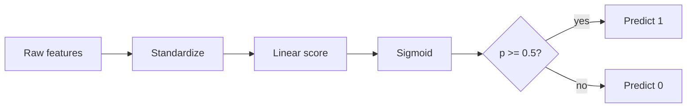

# Logistic Regression

A compact walkthrough of the model, its loss, and the computation pipeline
that trains it.

## Model

For an input $x \in \mathbb{R}^d$ with weights $w$ and bias $b$, logistic
regression predicts

$$ p(y=1 \mid x) = \sigma(w^\top x + b) = \frac{1}{1 + e^{-(w^\top x + b)}} $$

The sigmoid $\sigma$ maps the linear score $z = w^\top x + b$ onto $(0, 1)$,
turning a raw score into a probability.

## Loss

Training minimizes the negative log-likelihood (binary cross-entropy) over
$n$ labeled examples:

$$ \mathcal{L}(w, b) = -\frac{1}{n} \sum_{i=1}^n \Big[ y_i \log p_i + (1 - y_i) \log(1 - p_i) \Big] $$

$\mathcal{L}$ is convex in $w$ and $b$, so gradient descent converges to the
global minimum regardless of where it starts.

## Gradient

The gradient has a clean form because the sigmoid's derivative is
$\sigma'(z) = \sigma(z)\,(1 - \sigma(z))$:

$$ \nabla_w \mathcal{L} = \frac{1}{n} \sum_{i=1}^n (p_i - y_i)\, x_i $$

Each example pushes the weights in proportion to its own prediction error
$p_i - y_i$, scaled by its features.

## Pipeline

